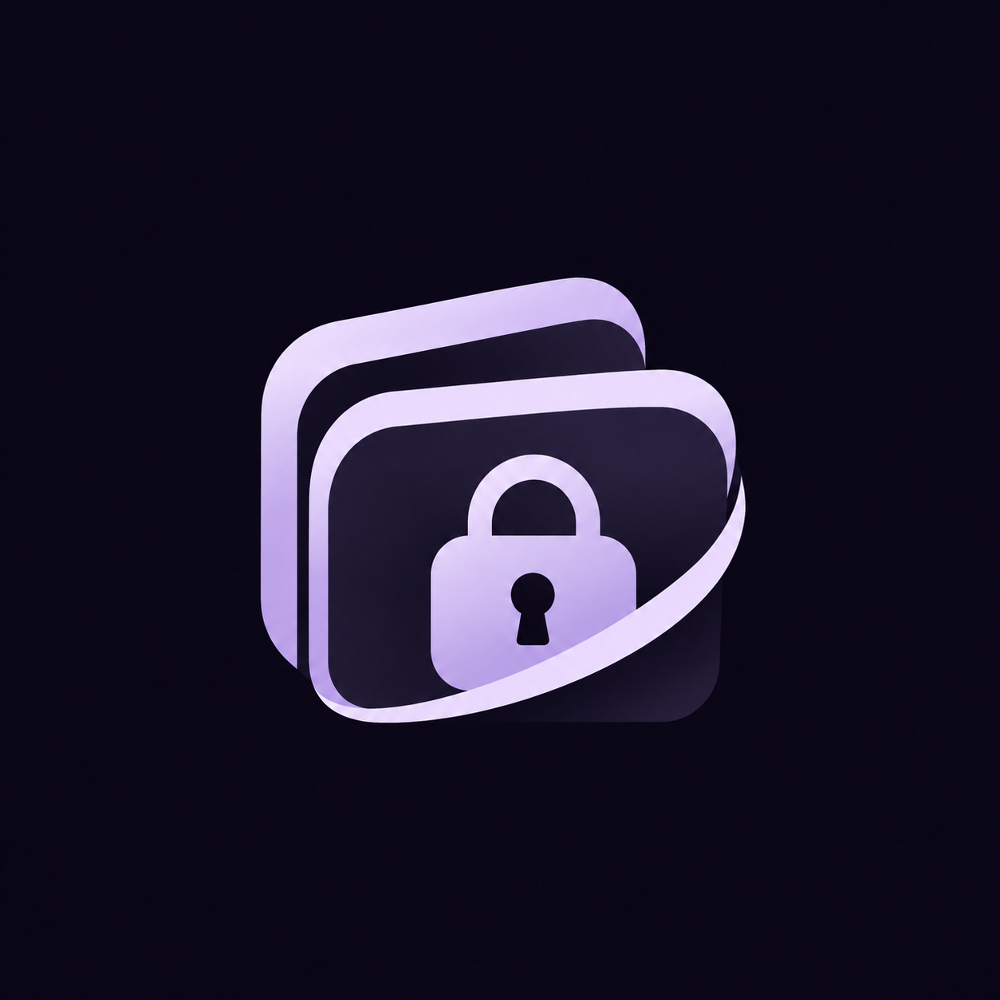

# 🛡️ Secure Save

<div align="center">
  
  <h3>Personal Zero-Knowledge Digital Vault</h3>
  <p>Client-side AES-256-GCM encrypted security for cards, passwords, bank accounts, and confidential collections.</p>

  <p>
    <a href="https://securesave.mraks.dev"><strong>🌐 Live WebApp</strong></a> •
    <a href="https://securesave.mraks.dev/docs"><strong>📖 Interactive Docs</strong></a> •
    <a href="https://github.com/Anjan-Kumar-Sahoo/Secure-Save/releases/latest/download/securesave.apk"><strong>📱 Download Android APK</strong></a> •
    <a href="https://secure-save-blue.vercel.app"><strong>⚡ Backend API</strong></a>
  </p>

  <p>
    
    
    
    
    
  </p>
</div>

---

## 🌟 Overview

**Secure Save** is a zero-knowledge, privacy-first personal vault. Secrets are encrypted locally on the user's device using **AES-256-GCM** before transmission. Only ciphertext is sent over the wire and saved to the cloud, ensuring neither the database nor the hosting platform can ever read or decrypt your sensitive records.

### Core Modules
* 💳 **Payment & ID Cards:** Store card numbers, CVVs, expiration dates, and cardholder details with quick clipboard copying.
* 🔑 **Passwords & Credentials:** Manage sensitive usernames, passwords, notes, and OTP recovery credentials.
* 🏦 **Bank Accounts:** Securely keep branch details, IFSC codes, routing numbers, and linked card references.
* 📁 **Universal Encrypted Files & Collections:** Store any file type (PDF, images, archives, docs up to 10MB) client-side encrypted with instant decrypted downloads, plus private notes and custom categorizations.
* 📲 **In-App Update System:** Mobile app automatically detects new releases on startup and allows single-tap APK updates.

---

## 🏗️ System Architecture

```
┌─────────────────────────────────┐        ┌──────────────────────────────────┐
│      WebApp (Vercel SPA)        │        │     Android APK (Capacitor)      │
│     securesave.mraks.dev        │        │         securesave.apk           │
│   Client-Side AES-256-GCM       │        │   Hardware Keystore & Biometrics │
└────────────────┬────────────────┘        └─────────────────┬────────────────┘
                 │                                           │
                 │              HTTPS / TLS 1.3              │
                 └───────────────────►◄──────────────────────┘
                                     │
                                     ▼
                  ┌───────────────────────────────────────┐
                  │    Backend API (Vercel Serverless)    │
                  │     secure-save-blue.vercel.app       │
                  │   Node.js • Express • Rate Limiter    │
                  │      JWT Sessions • Nodemailer        │
                  └──────────────────┬────────────────────┘
                                     │
                                     ▼ TLS Encrypted
                  ┌───────────────────────────────────────┐
                  │          MongoDB Atlas Cloud          │
                  │    Ciphertext-Only Document Storage   │
                  │    TTL Auto-Cleaning OTP Challenges   │
                  └───────────────────────────────────────┘
```

---

## 💻 Tech Stack

| Tier | Technologies |
| :--- | :--- |
| **Web Frontend** | React 18, TypeScript, Vite, Tailwind CSS, Framer Motion, TanStack Query, Zustand |
| **Mobile Client** | Capacitor 6, Android Keystore, Gradle 8, Automated GitHub Actions Releases |
| **Backend API** | Node.js, Express, Vercel Serverless Functions, Helmet, Express Rate Limit, Nodemailer |
| **Database** | MongoDB Atlas, Mongoose ODM with TTL auto-expiring verification challenges |
| **Cryptography** | Client-side AES-256-GCM, PBKDF2 (SHA-256) key derivation, bcrypt credential hashing |

---

## 📁 Repository Structure

```
secure-save/
├── apps/
│   ├── api/             # Vercel serverless Node.js Express backend
│   │   ├── api/index.ts # Serverless function entrypoint
│   │   └── src/         # Routes, controllers, database models, email templates
│   ├── webApp/          # Standalone React + Vite web application (securesave.mraks.dev)
│   │   ├── src/features # 3D Landing, interactive /docs, auth, and vault listings
│   │   └── vercel.json  # Client-side SPA routing rewrites
│   └── mobile/          # Capacitor-wrapped Android project & builds
│       └── android/     # Native Android source, splash assets, and launcher icons
├── packages/
│   └── shared-types/    # Monorepo shared TypeScript interfaces
├── docs/                # Extended system architecture and schema manuals
├── .github/workflows/   # CI/CD: Automated APK build and GitHub Releases
└── logo.png             # Official brand identity asset
```

---

## 🚀 Quick Start (Local Development)

### Prerequisites
* **Node.js** >= 20.x
* **npm** >= 10.x
* A free **MongoDB Atlas** cluster

### 1. Clone & Install
```bash
git clone https://github.com/Anjan-Kumar-Sahoo/Secure-Save.git
cd Secure-Save
npm install
```

### 2. Configure Environment Variables

**Backend (`apps/api/.env`):**
```env
PORT=3000
MONGODB_URI=mongodb+srv://<user>:<password>@cluster0.mongodb.net/securesave
JWT_SECRET=your_super_random_jwt_secret_key_minimum_32_characters
SMTP_HOST=smtp.gmail.com
SMTP_PORT=587
SMTP_USER=your_email@gmail.com
SMTP_PASSWORD=your_app_password
SMTP_FROM_NAME="Secure Save"
SMTP_FROM_EMAIL=your_email@gmail.com
CORS_ORIGIN=http://localhost:5173,https://securesave.mraks.dev
```

**WebApp (`apps/webApp/.env`):**
```env
VITE_API_URL=https://secure-save-blue.vercel.app/api
```

### 3. Run Development Servers
```bash
# Run WebApp dev server (http://localhost:5173)
npm run dev:webapp

# Run Backend API dev server (http://localhost:3000)
npm run dev:api

# Run Mobile dev server
npm run dev:mobile
```

---

## 🛠️ Build & Verification

```bash
# Compile and build WebApp production bundle
npm run build:webapp

# Compile Backend TypeScript
npm run build:api

# Build Mobile bundle
npm run build:mobile
```

---

## 📦 Deployment

### Backend API (Vercel)
1. Import repository on [Vercel](https://vercel.com).
2. Set **Root Directory** to `apps/api`.
3. Add environment variables (`MONGODB_URI`, `JWT_SECRET`, `SMTP_*`, `CORS_ORIGIN`).
4. Deploy!

### Frontend WebApp (Vercel)
1. Create a new project on Vercel importing this repository.
2. Set **Root Directory** to `apps/webApp`.
3. Framework Preset: **Vite**.
4. Set Environment Variable: `VITE_API_URL=https://secure-save-blue.vercel.app/api`.
5. Deploy!

### Android APK (Continuous Delivery)
Pushes to `main` trigger `.github/workflows/build-apk.yml`. GitHub Actions compiles the Android APK and automatically publishes it as `securesave.apk` under the [Latest Release](https://github.com/Anjan-Kumar-Sahoo/Secure-Save/releases/tag/latest).

---

## 🔒 Security Model

1. **Zero-Knowledge Encryption:** Data is encrypted on the client device before HTTP transport using AES-256-GCM.
2. **Brute-Force Protection:** Rate limiting (window of 15 mins / 100 requests) prevents credential guessing.
3. **Ephemeral Verification:** 6-digit OTP challenge codes expire in 5 minutes and are purged by MongoDB TTL indexes.
4. **Preflight & Origin Isolation:** Strict CORS origin whitelisting protects endpoints against unauthorized third-party browsers.

---

## 📄 License
This project is licensed under the ISC License. Made with ♥ by [AK](https://github.com/Anjan-Kumar-Sahoo).
